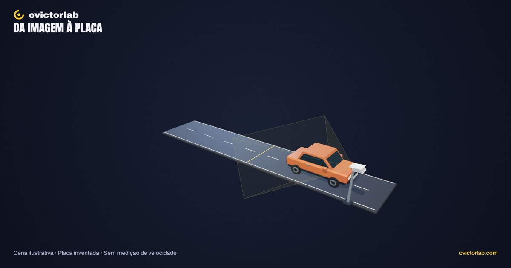
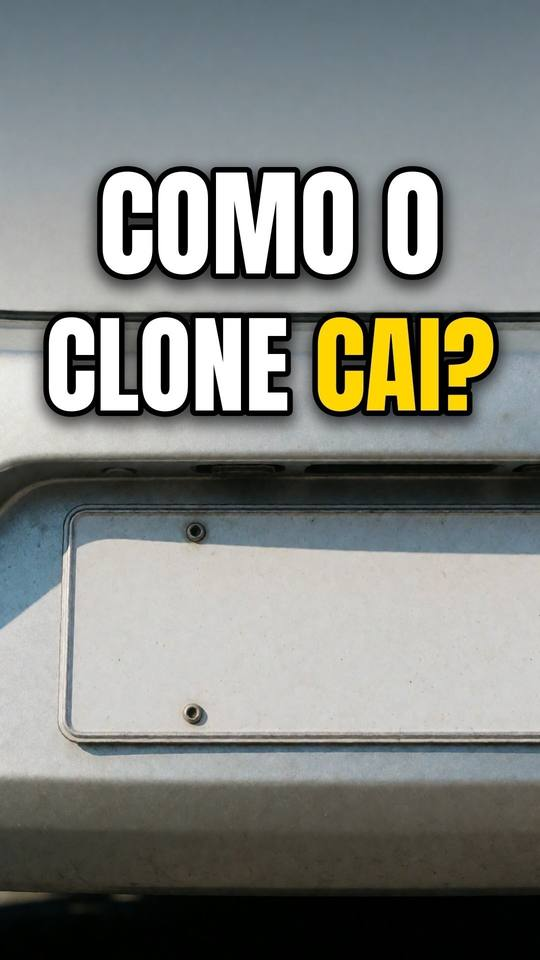

# Como o radar lê uma placa

**[Abrir a experiência →](https://victorsodre.github.io/radar-placas/)** · [Os 10 experimentos](docs/COLECAO.md) · [Publicação e manutenção](docs/PUBLICACAO.md)

[](https://victorsodre.github.io/radar-placas/)

**Como uma imagem vira uma sequência de letras e números?**

Um carro, uma câmera e uma placa fictícia. A experiência mostra captura, recorte e leitura em um fluxo didático local, com falhas ilustrativas identificadas.

Direção e autoria editorial: **Victor Sodré / ovictorlab**. [Site](https://ovictorlab.com/) · [Referência Fusquinha](https://victorsodre.github.io/fusquinha/) · [Repositório](https://github.com/victorsodre/radar-placas).

## Vídeo relacionado do canal

<a href="https://www.youtube.com/watch?v=F5GFaFoAbYg"></a>

**[Como descobrem que a placa do carro é clonada? (o clone aparece em dois lugares)](https://www.youtube.com/watch?v=F5GFaFoAbYg)**

O vídeo trata de placas clonadas. A experiência mostra captura, recorte e uma leitura demonstrativa; não identifica veículos reais.

O player incorporado fica [na página do experimento](https://victorsodre.github.io/radar-placas/#video), com carregamento por clique e sem reprodução automática.

## Por que desenvolver

O Reel registrou 177.582 visualizações, 892 salvamentos e 7.269 compartilhamentos no Instagram. Interesse em fiscalização pode diferir de interesse em modelagem; validar a interação no piloto. Consulta em 07/11/2026. Métricas acumuladas são sinais de interesse; não comprovam demanda pelo aplicativo ou alcance orgânico.

- [Leitura de placas — Instagram](https://www.instagram.com/reel/DeUKErfjT0-/)
- [Placa clonada — YouTube](https://www.youtube.com/watch?v=F5GFaFoAbYg)

## Começar por aqui

1. [Escopo e critérios de conclusão](docs/ESCOPO.md).
2. [Lista de execução](docs/EXECUCAO.md).
3. [Identidade visual do ovictorlab](docs/IDENTIDADE-VISUAL.md).
4. [Arquitetura e reaproveitamento do Fusquinha](docs/ARQUITETURA.md).
5. [Assets e fontes apuradas](docs/ASSETS-E-FONTES.md).
6. [Manutenção, validação e publicação](docs/MANUTENCAO.md).
7. [Decisões e estado do projeto](docs/DECISOES.md).
8. [Textos para o X](POSTAGENS-X.md) e [ordem da coleção](docs/COLECAO.md).

## Experiência entregue

Carro e placa cenográficos, câmera e campo de visão exploráveis. A passagem tem pausa, retomada e captura em um ponto fixo. Boa captura, ângulo aberto e pouca luz mudam a câmera ou a exposição; trocar a condição descarta o resultado anterior.

A câmera virtual gera uma imagem de 1280 × 720. O recorte usa os pixels dessa imagem. As etapas seguintes apresentam caracteres **pré-definidos**, com comparação à placa inventada LAB3D. Não há OCR real, consulta a cadastro ou medição de velocidade. Os limites aparecem junto ao resultado.

Seleção por lista/clique, busca, isolamento, foco, tour de quatro conjuntos, malha, tela cheia e PNG horizontal/vertical. Geometria e imagens autorais; marca e fontes locais do ovictorlab.

## Executar

Node.js >=22.18; versões exatas no lockfile.

```sh
npm ci
npm run dev
npm test
npm run check
npm run build
npm run preview
```

`dev`: http://127.0.0.1:4311/ . `preview` informa sua porta. Build estático em `dist/`, com base relativa e validação em subpasta. Sem backend, LLM, credenciais ou uso da GPU de produção.

## Evidências e limites

[Apuração](docs/APURACAO.md), [validação](docs/VALIDACAO.md) e [manutenção](docs/MANUTENCAO.md). Sete testes cobrem transições, invalidação, movimento, projeção e enquadramento; 117 verificações de navegador aprovadas. Validação móvel por viewport do Chrome no Mac, sem telefone físico.

O carro, a câmera, a iluminação e o trajeto são ilustrativos. Não há sensor calibrado, taxa de acerto, identidade de proprietário ou constatação de infração. Capturas ficam apenas na memória da página; reiniciar ou alterar a condição as descarta.

[POSTAGENS-X.md](POSTAGENS-X.md) contém rascunhos para Victor publicar depois. Nenhum aplicativo ou postagem social foi publicado.
